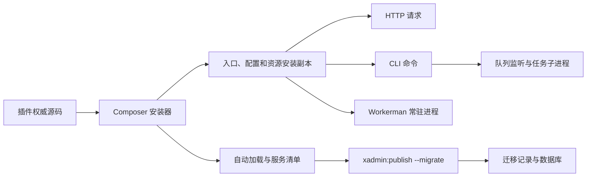

# 架构、升级与发布约定

本文件是聚合仓库安装、升级、验收和发布规则的统一来源。整改复核基线为
`8ce414a..16b4921`。支付、商城并发和设备协议不属于本次业务审计范围。

## 模块与运行生命周期

| 模块 | 职责及直接依赖 |
| --- | --- |
| 聚合项目 | 维护插件源码、开发入口、验收与拆分；path 仓库用于开发，独立 Composer 包用于分发 |
| ThinkLibrary | 注册服务和中间件，提供 ORM、运行配置、命令、队列、迁移与备份支持 |
| static | 入口、基础配置及前端资源模板，通过外部 think-install 安装 |
| admin | 后台权限、菜单、配置、任务；依赖 Library、static |
| account | 终端账号、会员与令牌；依赖 Library |
| payment | 支付、余额、退款；依赖 admin、account |
| wemall | 商品、订单、会员与返佣；依赖 account、payment，支付事件驱动订单状态 |
| wuma | 物码、库存、代理与标签；依赖 admin、wemall |
| wechat / wechat-service | 微信公众号与开放平台；依赖 Library、微信 SDK 和安装器 |
| center | 插件信息及管理入口；依赖 Library |
| worker | 基于 Workerman 的 HTTP 和自定义进程；依赖 Library，实际运行时不是 Swoole |
| helper | 开发期模型与索引辅助；要求 PHP 8.1+，不纳入 PHP 7.2 运行依赖 |
| think-install | 外部 Composer 插件，负责复制、初始化、包清理和安装后的发布命令；不在本仓修改 vendor |



- HTTP：Nginx/FastCGI → PHP-FPM → public/index.php → RuntimeService::doWebsiteInit → Http::run/end；
  Library 初始化时注册中间件，HttpEnd 清理请求内 sysvar。
  `php think run` 使用 ThinkPHP 内置开发服务器和 static 的 router，单独记录验证结果，不能替代 FPM。
- CLI：think → RuntimeService::doConsoleInit → Console::run；框架拥有自动退出和异常捕获设置，
  项目入口不额外 exit。调用方关闭自动退出后获得返回码，关闭异常捕获后接收原异常；
  入口未捕获异常的处理边界见下文“命令失败状态”。
- Workerman：xadmin:worker → HttpServer::onWorkerStart → ThinkApp，每个工作进程初始化一次；
  每次请求复用应用，重置请求、会话、视图和查询计数，再执行 Http::run/end。
- 队列：xadmin:queue listen 扫描等待任务，任务子进程执行 dorun 并记录状态；
  失败任务状态与监听进程状态分别验收，任务失败不要求整个监听进程退出。

## 文件所有权与配置

| 权威源 | 安装位置 | 更新规则 |
| --- | --- | --- |
| static 的 stc/think、stc/public/index.php | think、public/index.php | copy 的 ! 强制替换，不能在安装副本长期维护修改 |
| static 的 stc/config、.env.example、自定义样式模板 | config、.env.example、public/static/extra | init：目标文件已存在则保留 |
| static 的 plugs、theme 和内置脚本 | public/static 对应位置 | copy/! 更新；目标或父目录存在 ignore 时跳过 |
| admin、wechat 的 src | app/admin、app/wechat | 强制替换；发布包安装后可清理 vendor 中的源包 |
| 各插件 stc/database | database/migrations | 安装器 copy 更新；迁移记录决定是否执行，不能通过删记录重跑生产迁移 |
| worker 的 stc/worker.php | config/worker.php | init 保留用户配置 |
| 用户 .env、自定义配置和业务文件 | 站点目录 | 用户所有，不纳入模板清理或强制重置 |
| installed.json | vendor/services.php、versions.php | Publish 根据实际安装包重新生成，不能手工维护生成结果 |

static 的主题发布包同时保留 Less 源码、预编译 CSS 和 css/package.json，确保 Composer 安装后
仍可按 README 执行主题构建。该清单属于安装产物，不按仓库维护文件排除；只恢复站点副本
无法修复发布包缺失，默认主题更新仍按上表替换，ignore 保留规则不变。

xadmin:publish 还发布应用模块内的 config、public、database：配置和迁移默认不强制覆盖，
静态资源覆盖；--force 会扩大覆盖范围，常规升级不使用。迁移改名清理由现有 Publish 实现处理，
不能用目录清理替代迁移兼容设计。

配置顺序：应用初始化加载环境与 config；运行模式、应用映射和域名映射由 runtime/.env 合并。
旧 migration 3.0.0 读取 database 顶层，而 ORM 读取 connections。Library::boot 仅用默认连接补齐
缺失的顶层项，保留显式值和整个 connections。该逻辑在 HTTP、CLI 和 Worker 共享执行；
只有观察到副作用且存在现成接入点时才收敛，不能搬到不负责连接配置的 config/phinx.php。

## 近期提交处置

| 提交 | 处置与依据 |
| --- | --- |
| ef91cf6 | 保留旧迁移连接兼容、PDO 失败显式异常、通用字段类型及既有 PhinxExtend 复用；以真实安装升级和配置一致性复核影响 |
| 1af53b6 | 保留示例 MySQL 主机和 Redis 库号修正；实际用户 .env 不修改 |
| 5eecf72 | 保留统一测试入口、源码 SHA 固定、冲突预检和并发保护；补真实安装器、真实拆分及发布证据关联 |
| 16b4921 | 保留无额外 exit 的入口和 Publish 直接运行迁移子命令；其普通异常测试不能代替所有 Throwable 与初始化失败验收 |

最小修正：真实安装器补验已复现并修正根项目自动加载缺陷，原 app\index\ 映射只能加载首页模块。
发布包复制 app/admin、app/wechat 并清理 vendor 后，对应服务无法注册。根项目改为 app\ → app/，
延续框架原有应用目录规则；path 与 dist、基础与完整插件组合均通过真实服务注册检查。

命令失败状态：修复前 PHP 7.2/ThinkPHP 6.1 和 PHP 8.2/ThinkPHP 8 两条依赖线中，
原生 Console 与本仓入口对 Error/TypeError、服务 boot 异常均可输出错误但以 0 退出。
Console::run 只捕获 Exception，初始化又发生于 run 之前；全局异常处理器只 report/render。
static 权威模板及根 think 仅在入口直接被 CLI/phpdbg 执行且异常逃出控制台时，清除当前
异常处理器并重新抛出原 Throwable，由 PHP 原生未捕获机制产生非零状态。此边界不添加 exit，
不修改共享服务、HTTP 入口或 vendor；入口被其他脚本包含时保留调用方处理器并传递原异常。
正常返回和显式状态码继续由 Console 控制。
两个含 shebang 的入口不声明 strict_types：PHP 7.2 在包含此类脚本时将 shebang 视为前置输出，
会在进入运行服务前报编译错误。移除此入口声明以兼容包含调用，服务内的类型声明保持原样。

tests/check-console.php 与 tests/check-composer.php 分别对项目两个入口和真实 Composer 更新
继续严格要求失败非零。
不注册 Library 的原生 ThinkPHP 对照单独输出 CONTROL、实际退出码及是否满足项目约定，
确认故障标记真实出现，但不将其默认退出行为作为项目门禁，也不将对照标记为通过。
包含两个实际入口的回归同时验证 autoExit=false 后继续执行、catchExceptions=false 时原异常
传递，以及调用方异常处理器保持不变。通过项目原始失败场景及完整矩阵后才能解除发布阻断。

2026-10-14 继续核查官方版本：6.1、8.x 分支最新提交仍分别为 bc1045b、ced4837，与本次验收锁定
的提交一致。另在 Docker 内仅安装官方框架、不加载 ThinkLibrary 的最小应用中验证稳定版：

| PHP / 框架 | Error / TypeError / 服务 boot 异常的实际退出码 | 调用方控制 |
| --- | --- | --- |
| 7.2.34 / v6.1.5（57d1950） | 0 / 0 / 0，失败 | 关闭自动退出后返回、捕获原异常均通过 |
| 8.2.34 / v8.1.4（8e7b2b2） | 0 / 0 / 0，失败 | 关闭自动退出后返回、捕获原异常均通过 |

当时验证表明，仅切换到这两个稳定版不能解除阻断。已有 autoExit、catchExceptions 开关控制正常，
但不能补齐 Throwable 捕获，也不能覆盖发生于 Console::run 之前的初始化异常。
项目要求覆盖命令执行和未捕获的初始化失败；两者不在同一个捕获范围内，不能用全局退出补丁
替代责任边界分析。行为位置可对照官方 [Console::run](https://github.com/top-think/framework/blob/57d1950a1844ef8d3098ea290032aeb92e2e32c3/src/think/Console.php)
和 [Error::appException](https://github.com/top-think/framework/blob/8e7b2b2364047cbf71a38c4e397a9ca0d4ef2b01/src/think/initializer/Error.php)。

嵌套调用还需区分 `find()->run()` 和 ThinkPHP 的 `Console::call()`：后者会将当前控制台的
catchExceptions 设为 false，且不会恢复。即使内层命令成功，随后外层抛出普通异常也可能由
全局处理器输出后以 0 退出。Publish 已使用前者执行迁移，应保留；队列的命令调用外层已有
Throwable 捕获并记录任务失败，不能为了退出码统一改写所有 call 调用。
补充验收同时覆盖两种嵌套方式，调用方关闭自动退出后的继续执行，以及覆盖整个入口的
try/catch 接收配置和服务启动异常。失败命令在关闭自动退出时允许非零返回或原异常传递；明确关闭
异常捕获时必须传递原异常，不以强制退出满足进程验收。

PHP 7.2 原生对照还复现了 think-helper 3.1.12 的语法错误：Arr::random 的函数调用含尾随逗号，
但该包仍声明 PHP >=7.1。ThinkLibrary 已有 conflict 排除该版本，本项目四组锁文件均为 3.1.11，
应保留此约束；上述 PHP 7.2 稳定版对照也使用 3.1.11，避免无关依赖错误干扰结论。
该次对照未调整项目依赖、vendor 或异常处理行为，原生复现、锁文件和失败日志保留在本地验收证据中。

2026-10-16 入口局部修复的宿主验证：PHP 8.4.14 下先确认两份入口各有四类故障退出 0，
修复后 18 项直接执行、28 项包含入口及 14 项运行服务调用检查全部通过；9 项原生对照保留
实际结果。入口语法和验收脚本风格检查通过；这些局部结果不替代下述 Docker 四组矩阵。
随后 Docker 7.2 检出上述 shebang 编译限制，独立最小脚本复现失败，移除入口声明后可正常包含；
PHP 8.2 的相同对照均正常。四组矩阵须使用修正后的干净提交重新记录。

## 验收与证据

Docker 统一入口为 `bash tests/docker/run.sh`，依次运行既有四组矩阵：

| PHP | ThinkPHP / migration | MySQL | 范围 |
| --- | --- | --- | --- |
| 7.2 | ^6.1 / 3.0.0 | 8.4 | 原完整回归与新增验收 |
| 8.2 | ^8.1 / ^3.1 | 8.4 | 原完整回归与新增验收 |
| 7.2 | ^6.1 / 3.0.0 | 5.7 | 升级与新增验收 |
| 8.2 | ^8.1 / ^3.1 | 8.0 | 升级与新增验收 |

两条 PHP 依赖线均验 SQLite。也可指定单组：
`bash tests/docker/run.sh 8.2 8.4 full`。MySQL 8 专有默认表达式不作为 5.7 的支持承诺。
PHP 7.2 镜像仅用于旧版本兼容验收，不作为生产运行镜像。

镜像拉取和构建准备仅在日志表明限流、超时等网络故障时最多尝试三次，间隔 5、15 秒；
构建语法错误或鉴权失败立即终止。已有匹配平台的 MySQL 镜像可复用，否则先显式拉取。
每次尝试的日志分别保留，实际镜像 ID/摘要仍写入 images.txt；最终准备失败写入
preparation-status.txt，明确对应测试未运行。该重试不包裹真实安装钩子、迁移或验收检查。
GitHub Actions 四组矩阵最多同时运行两组，以降低镜像服务的瞬时请求量。
2026-10-16 已用临时故障注入验证恢复、持续限流、超时、构建错误和鉴权失败五种分支，
次数、等待间隔、逐次日志和未运行标记符合上述规则；Bash、ShellCheck、Actionlint 检查通过。
故障注入只验证准备控制流，真实 Docker 及远端验收仍按四组结果判定。

- composer test / tests/run.php：现有核心与业务回归、权限、令牌及隔离 CLI 迁移。
- tests/check-console.php：真实进程退出码、初始化失败、Throwable、嵌套调用及调用方控制权。
- tests/check-composer.php sqlite|mysql：真实安装器、path/zip 两种分发、后台基础组合与全部运行插件，
  新装、模拟旧库更新、失败重试、锁文件重装、配置保留、服务注册及独立库恢复余额样本；
  本地插件 zip 使用临时 Git 索引归档，实际应用 export-ignore；安装及默认主题重装后核对
  主题构建清单、Less 源码和预编译 CSS。已安装站点补验普通异常、未定义函数和参数类型错误
  的失败迁移，核对 shell/进程状态及迁移记录。
- tests/check-lifecycle.php sqlite|mysql web：分别启动 `php think run` 和 Nginx/PHP-FPM，覆盖真实
  HTTP 请求、初始化异常及 Exception/Error/TypeError/数据库错误后的同一进程恢复、会话与配置隔离及事务回滚。
  使用 static 配置、router 和 admin 迁移；两个入口只注入临时应用根目录，复用真实运行服务。
  FPM 固定单个非 root worker，通过响应的 `PHP_SAPI=fpm-fcgi` 与进程号验证请求链。
- tests/check-lifecycle.php sqlite worker：Workerman 连续请求、异常恢复、请求状态和会话隔离，
  以及队列启动、任务失败、后续任务成功和停止；不以该结果替代 FPM 验收。
- tests/check-release.php：真实 splitsh、本地 bare 仓库、发布凭据、标签冲突、重跑、过期来源与并发覆盖保护；
  源码仓库和远端均为隔离夹具，门禁输入是合成证据，不能冒充主仓发布或数据库验收结果。

依赖准备发生在容器内的源码快照，不挂载宿主 .env、vendor 或数据库。真实安装测试使用锁文件
对应的本地包仓库，关闭 Packagist，预置 binarys.php 防止安装器上报主机标识。安装器本身及其
安装、更新、post-autoload-dump 事件照常执行。

每组证据保存在 runtime/acceptance：源码 SHA、工作区差异、源码归档哈希、镜像 ID、依赖锁文件、
PHP/FPM/Nginx/Composer 版本、各检查日志和退出状态。FPM 和 Nginx 的访问、错误及进程日志也保留，
正常停止需返回 0。各独立检查全部执行，任一失败使整组失败。发布门禁要求 `http-sqlite`、
`http-mysql` 检查与 FPM/Nginx 版本证据，旧的仅 CLI/Workerman 结果不能作为新 FPM 验收凭据。
带工作区改动的结果仅用于开发验收，不能作为发布某一 Git 提交的证明。
复现某组已记录依赖时，在对应源码上设置 THINKADMIN_ACCEPTANCE_LOCK 为该组证据内 composer.lock
的绝对路径，再运行单组 Docker 命令；依赖准备将改用 install，避免重新解析版本。

真实 Composer 验收的旧库通过截断迁移至 20241010000009 构造，不能冒充生产快照。
独立数据库恢复覆盖余额样本；既有 PhinxRoundTripTest 覆盖字段、索引、SQLite 序号、精度和
损坏记录回滚。其触发器用例仅验证 SQLite 原地修改表结构时保留触发器，不能证明导出后重建
触发器；完整恢复边界见下文“数据库备份与恢复边界”。生产规模、真实支付通道、设备和切流
仍需现场验收。

### 2026-10-14 本地验收结果

以下为本次开发快照的实际结果，工作区差异已经记录，不能作为某一干净提交的发布凭据。

| 环境 | 既有回归或升级 | 真实 Composer、恢复样本与服务生命周期 | 命令失败状态 | 整组结果 |
| --- | --- | --- | --- | --- |
| PHP 7.2 / MySQL 8.4 / SQLite | 已通过，137 tests / 689 assertions | 已通过 | 失败 | 失败 |
| PHP 8.2 / MySQL 8.4 / SQLite | 已通过，137 tests / 689 assertions | 已通过 | 失败 | 失败 |
| PHP 7.2 / MySQL 5.7 / SQLite | 已通过，安装与升级 | 已通过 | 失败 | 失败 |
| PHP 8.2 / MySQL 8.0 / SQLite | 已通过，安装与升级 | 已通过 | 失败 | 失败 |

四组共完成 40 个真实 Composer 场景，包含 path/dist、新装、模拟升级、唯一约束失败与按锁文件
重试，并验证 `--no-dev --optimize-autoloader`。语法、包元数据、既有代码风格范围与新增脚本
检查已通过。PHPUnit 11 仍报告既有测试注解弃用提示。

实际 PHP 为 7.2.34、8.2.34；框架分别锁定为 6.1.x-dev（bc1045b）、8.x-dev（ced4837），
迁移为 v3.0.0（0ca9582）、3.1.x-dev（a72129d），安装器为 dev-master（07ce1b1）。
完整提交号、其他依赖与镜像标识以各组 composer.lock、dependencies.json 和 images.txt 为准。

真实 splitsh 与本地 bare 仓库的隔离发布演练已通过，覆盖失败阻断、拆分目录树、标签绑定、
重复发布、远端偏移、冲突、过期来源和并发保护。主仓正式发布资格仍受阻：每组命令检查均复现
三个入口的 Error、TypeError、服务 boot 异常退出码为 0；四组总退出码均为 1，没有生成有效发布凭据。
真实远端推送、主仓标签发布、生产全量恢复和现场切换均未运行。

### 2026-10-14 定向补验

沿用上轮锁文件，在 Docker 的 PHP 7.2 / ThinkPHP 6.1、PHP 8.2 / ThinkPHP 8 中补齐命令检查。
每条依赖线均执行 41 个场景：29 通过、12 失败。失败为根入口、static 入口和原生框架对照各自
出现的四类零退出：Error、TypeError、服务 boot 异常，以及 Console::call 成功后外层普通异常。
调用方关闭自动退出的 7 个场景、关闭异常捕获的 5 个场景和初始化异常传递的 2 个场景全部通过。

两条依赖线的 SQLite 安装、历史库升级、配置与数据保留、失败重试和重复执行均通过，覆盖
无前缀及 tenant_；当前 Publish 的直接子命令调用仍能让普通迁移异常返回非零。
真实 splitsh / 本地 bare Git 补验共 9 组通过，新增覆盖单项失败与总状态冲突、重复检查、缺失
日志和矩阵，以及第二个插件拒绝推送后的局部成功、凭据阻断和修复后重跑。

本轮仅修改验收脚本及本文，未修改 ThinkPHP、业务运行代码或两个 think 入口。
PHP 7.2 首次依赖下载曾出现 SDK 压缩包损坏，隔离重新下载后恢复，原日志保留。
PHP 8.2 上述结果来自首次有效补验；最终复跑在连续两次 ip2region 下载连接中断后停止依赖
准备，未进入测试，单独记为环境受阻。最终脚本的 PHP 8.2 语法检查已通过，不以语法检查
代替运行结果；调整后断言的运行复核已在 PHP 7.2 完成。
证据位于本地 runtime/acceptance/followup.n2Wglw，记录实际源码差异、依赖、镜像和日志；
这些是定向开发验收，不是新的完整四矩阵发布凭据。MySQL、HTTP、Workerman 和队列沿用前轮
结果，本轮未重跑。命令退出码仍失败，生产更新与正式发布继续受阻。

### 2026-10-14 验收口径与真实迁移复核

曾将 Error、TypeError、服务 boot 异常和 Console::call 后外层异常的退出码 0 标为
`framework-handled`，由此得到的四组全绿不满足原验收要求。该断言调整已撤回，未提交到代码库；
“框架已输出错误”和“部署能够识别失败”必须分别判断。以下目录保留原始记录，但不得用其中的
命令通过状态认定发布通过：

- php7.2-mysql8.4.6wSpPE、php8.2-mysql8.4.Kgs0Zk；
- php7.2-mysql5.7.viBdSh、php8.2-mysql8.0.GbVlVB。

上述四组均包含未提交改动；逐组调用 verify-acceptance.php 已确认现有发布门禁拒绝这些凭据。

本轮沿用上述锁文件，在 Docker 中重新运行两条依赖线的原命令门禁，并补验真实 Composer
安装后的 SQLite 站点。入口哈希与 static 模板一致，没有替换应用初始化调用；安装器原有
post-autoload-dump 钩子实际执行。临时迁移分别触发普通异常、未定义函数和参数类型错误，
同时从 shell 和进程接口读取状态，再检查失败迁移没有登记完成。

| Docker 依赖线 | 命令门禁 | 普通迁移异常：Publish / Composer | 未定义函数及类型错误：Publish / Composer |
| --- | --- | --- | --- |
| PHP 7.2.34 / ThinkPHP 6.1 | 29/41 通过，12 失败 | 1 / 1，已通过 | 均为 0 / 0，失败 |
| PHP 8.2.34 / ThinkPHP 8 | 29/41 通过，12 失败 | 1 / 1，已通过 | 均为 0 / 0，失败 |

两条依赖线共 12 项迁移故障检查：4 项通过、8 项失败；shell 与进程采集一致，失败迁移记录均为
0。故障注入用于验证升级失败能否被识别，不代表现有业务迁移含有这些编程错误。每条依赖线原有
5 个 Composer 安装场景继续通过，包含配置、数据、重复执行和恢复检查；此次新增故障场景的
MySQL 分支未运行。MySQL、HTTP、Workerman、队列和真实 splitsh 沿用此前各自有效的验收结果，
没有用 SQLite 结果替代其他环境。

证据保存在本地 runtime/acceptance/command-recheck.7qb44s，含源码差异、镜像、依赖锁文件和
实际输出。两组检查最终状态均为失败，不能生成发布凭据。新增脚本通过 PHP 7.2/8.2 语法检查，
本次测试差异通过代码风格检查；故障迁移、站点和容器均已清理。原生对照及真实安装结果共同说明
当前调用链的失败状态不足以满足项目部署要求；本轮仅补验收与说明，没有修改运行时代码、
ThinkPHP 或两个 think 入口，也未添加全局退出补丁。正式发布及生产更新继续受阻。

## 拆分与标签发布

主仓 CI 与本地调用同一 Docker 入口，失败也上传证据。split 作业等待四组检查全部成功，
下载该次运行的证据；verify-acceptance.php 再核对源码提交、干净工作区、矩阵完整性和各检查状态。
检查缺失或失败都不生成可用于发布的凭据。
本地历史验收结果默认保留；本地拆分时通过 THINKADMIN_ACCEPTANCE_DIR 指向仅包含本次四组证据的
目录，避免混入旧结果或重复矩阵。CI 自动收集本次运行的四组产物。

真实 splitsh 从固定源提交拆分；全部插件推送成功后才输出 split.tsv 与 acceptance.json。
前者记录源 SHA、分支、验收摘要哈希及每个插件的拆分 SHA，后者记录依赖锁文件和镜像证据哈希。
部分拆分失败时修复后重跑，不把局部成功当作整体发布成功。

从对应 CI 运行下载 release-manifest-<源码 SHA>，在该源码提交的干净分支上预检：

```sh
bash .github/release.sh --dry-run --manifest /path/to/split.tsv vX.Y.Z [插件名 ...]
```

获得实际发布授权后，同一命令去掉 --dry-run 才创建并推送指定标签。--manifest 为必填，
脚本核对源提交、凭据哈希、全部目标的远端分支与拆分 SHA，任一不符在创建标签前失败。
同一标签指向同一已验收拆分时可重跑，指向其他提交时拒绝覆盖。插件 GitHub Release 仍绑定
触发标签，允许重跑和补发既有标签；根项目 Release 仍等待四组验收。

Release 正文以触发标签的 Git 提交历史生成具体条目及提交链接，不依赖仅按合并 PR 汇总的
GitHub 自动说明。完整检出历史后，从触发标签父提交向前寻找最近的版本标签；稳定版本跳过
预发布标签，首次发布列出该标签全部历史，补发旧版不包含后续提交。已有 Release 重跑保留
原正文，历史缺失正文通过明确修订补充，不移动标签或覆盖人工说明。
主仓 `.github/workflows/release.yml` 是发布步骤的权威实现，各插件保留相同步骤供独立仓库执行；
`tests/check-release.php` 对照全部副本并执行真实 Git 历史场景，gh 仅用本地记录器模拟远端创建。

这个对应关系证明正常维护脚本发布的代码来源，不是签名或权限系统：有远端写权限的人仍能绕过
维护脚本手工打标签。应按现有仓库权限管理限制实际发布入口，本轮不修改远端规则。

## 数据库备份与恢复边界

`php think xadmin:package --all` 生成安装数据包；`php think xadmin:publish --migrate` 执行生成的迁移。
这条链路不具备完整数据库快照语义：排除迁移记录，默认不导出队列和操作日志数据，非空目标表
直接跳过；未导出触发器，也未保存 MySQL 删除高位记录后的历史自增上界。恢复生产业务库使用
数据库原生备份，并保持匹配的代码、锁文件和配置；不能仅靠安装包替代灾难恢复备份。

新生成的安装包在 PHP 迁移脚本内保存每个 `.data` 文件的 SHA-256 摘要，在对应空表写入前校验。
空文件、按完整行截断和内容变更都会失败；恢复完整文件后可重试。数据文件格式不变，旧脚本和
旧 JSONL 仍可读取，但没有摘要的历史备份无法自动识别合法截断，需要已有可信校验清单或重新
备份。脚本和数据文件必须一起保存，恢复时使用包含本次修复的 ThinkLibrary；摘要校验不提供
来源认证，也不证明备份时多表数据处于同一事务快照。非空表和 dry-run 仍按原约定跳过读取。

MySQL 在独立目标库演练原生逻辑备份。下面的变量分别指已确认的源库、独立空目标库和新备份
文件；连接信息保存在对应客户端配置中。先检查命令退出状态，再核验数据、结构和业务不变量。
`--single-transaction` 的一致性适用于事务表，备份期间禁止 DDL；非事务表另行安排停写。

```sh
mysqldump --defaults-extra-file=/path/backup.cnf --single-transaction --quick \
  --hex-blob --routines --events --triggers --set-gtid-purged=OFF \
  --default-character-set=utf8mb4 "$BACKUP_DB" > "$BACKUP_FILE" &&
sha256sum "$BACKUP_FILE" > "$BACKUP_FILE.sha256"

sha256sum --check "$BACKUP_FILE.sha256" &&
mysql --defaults-extra-file=/path/restore.cnf --default-character-set=utf8mb4 \
  "$RESTORE_DB" < "$BACKUP_FILE"
```

SQLite 本轮验证的是停写、关闭全部连接后的单文件离线副本，源库使用 DELETE 日志模式。
若生产使用 WAL，须另验 checkpoint 和快照流程，不能在运行中只复制主 `.db` 文件。
恢复到独立路径后核对表结构、索引、数据、触发器与自增序号，验证通过后再安排现场切换。

## 更新与恢复

1. 在预发布环境使用目标依赖锁文件和对应源码执行上述验收，确认没有失败或阻断。
2. 备份现有源码版本、composer.lock、用户配置和数据库，记录恢复目标并验证备份可读取；
   按上述原生备份方法在独立数据库演练实际所需恢复，不覆盖在线数据库。
3. 安排维护窗口，停止写入来源及旧 Worker/队列，使用已验收的锁文件执行
   `composer install --no-dev --optimize-autoloader`，由安装器触发 Publish 和迁移。
4. 同时检查命令状态、迁移记录与服务可用性；当前已知异常退出阻断未解除时不进入生产更新。
   成功后重启常驻进程，验证正常请求、失败请求后的恢复及队列任务，再恢复业务写入。
5. 失败时保留日志和迁移记录，修复原因后按锁文件重试。MySQL DDL 可能隐式提交；
   若需要恢复，按已演练步骤恢复数据库与匹配代码，不能仅回退代码假定数据已回退。

真实推送、标签发布、生产备份恢复和流量切换需要对应操作授权；本地验收不会执行这些操作。

## 2026-10-15 本月回归修复复核

本次针对 `40c4163..04c9cc3` 的复核确认并修复两处本月新增问题：

| 问题 | 修复 | 结果 |
| --- | --- | --- |
| PHP 7.2 / migration 3.0.0 的 SQLite PDO 静默模式下，备份约束失败只返回 false，恢复行数仍递增并登记迁移 | `PhinxBackup::insertRows` 显式检查 `PDOStatement::execute()`，失败抛出异常并复用既有保存点回滚；新增静默 PDO 回归测试 | PHP 7.2 实际冲突恢复：退出 1、实际 0 行、无迁移记录；PHP 8.2 同场景通过 |
| Wemall 新迁移直接使用 `PhinxSchema`，但 Composer 允许只保留旧 ThinkLibrary | Wemall 直接声明 `zoujingli/think-library` 为 `^6.1.100|dev-main|dev-master`；`v6.1.99` 不含该类，`v6.1.100` 起提供 | 只更新商城且不允许依赖联动时 Composer 安全拒绝；使用验收入口的 `--with-all-dependencies` 自动更新 Library 后迁移通过；两包同步更新通过 |

修复后的定向包测试在 PHP 7.2 / ThinkPHP 6.1 和 PHP 8.2 / ThinkPHP 8 均通过：ThinkLibrary 61 tests / 420 assertions，Wemall 18 tests / 89 assertions。四组 Docker 验收中，语法、元数据、核心回归或升级、生命周期和拆分发布检查通过；Console 与 Composer 检查仍因既有 Error、TypeError、boot 及嵌套命令失败返回 0 的门禁而失败，四组没有生成发布资格凭据。该既有阻断未在本次月度回归修复中扩大处理，生产上线仍须先解除命令失败门禁并重新跑完整矩阵。

本次证据保存在 `runtime/acceptance/month-review.rhikyb` 及四组新验收目录；当前工作区的修复差异可通过 `git diff` 复核。未执行真实远端推送、标签发布、生产数据库恢复或现场切换。

## 2026-10-15 FPM 与 think run 验收

以 `f7c50f2` 加本次测试差异为开发快照，沿用上一轮四组依赖锁文件，实际补验结果如下。
每格 HTTP 结果均包含 SQLite 和该行 MySQL 的真实请求，不以 CLI 或 Workerman 结果代替。

| 环境 | Nginx / PHP-FPM | php think run | 核心回归或升级 | 整组发布门禁 |
| --- | --- | --- | --- | --- |
| PHP 7.2.34 / MySQL 8.4 | 已通过 | 已通过 | 已通过 | 失败 |
| PHP 8.2.34 / MySQL 8.4 | 已通过 | 已通过 | 已通过 | 失败 |
| PHP 7.2.34 / MySQL 5.7.44 | 已通过 | 已通过 | 已通过 | 失败 |
| PHP 8.2.34 / MySQL 8.0 | 已通过 | 已通过 | 已通过 | 失败 |

已验证正常请求、TypeError、普通异常、Error、真实数据库查询错误和应用初始化异常后，
同一 worker 仍可继续响应；HTTP 错误状态为 500，正常请求为 200，会话隔离、配置稳定、
数据保留与事务回滚均通过。Nginx/FPM 正常停止的退出码均为 0。初始化故障对应日志中的
`LIFECYCLE_INIT_FAILURE` 为预期注入，后续请求的 PID 未变化。实际 Nginx 为 1.14.2 / 1.26.3。

两条完整回归各为 139 tests / 692 assertions，另两组升级、四组 Workerman/队列和本地拆分发布
检查通过。Console 以及 SQLite/MySQL Composer 故障注入仍因 Error/TypeError 等失败返回 0
而不满足门禁，四组总退出码均为 1；本轮没有解除该阻断，也没有生成发布凭据。

首轮新增数据库故障夹具误用了无条件 `find()`，该调用按 ThinkPHP 约定不执行 SQL，不能注入
数据库错误；改为显式查询不存在的表并隔离各模式数据后重跑通过，没有修改 ORM 或业务逻辑。
MySQL 5.7 首次容器启动退出 139，PHP 验收未开始；同镜像重建隔离实例后完成上述测试，
该次环境故障的确切根因尚未定位，原始记录保存在 `php7.2-mysql5.7.A8Lu3x`。

最终四组证据位于 `runtime/acceptance/` 下的 `php7.2-mysql8.4.4w3526`、
`php8.2-mysql8.4.nlRTjU`、`php7.2-mysql5.7.ucuhPf`、`php8.2-mysql8.0.evqAWM`。
这些是包含测试差异的开发验收，不能作为干净提交的发布证明。临时站点、数据库和容器已回收。
生产配置、多 worker 并发负载、生产快照恢复和现场切换未运行；本次结论限定为上述请求链及
升级场景，不代表整站业务或生产容量已经验收。

## 2026-10-15 数据备份与恢复补验

以 `69138c6` 加本次修复为开发快照，通过真实 `xadmin:package --all` 生成迁移及数据文件，
再用 `xadmin:publish --migrate` 恢复至新建的独立数据库，覆盖无前缀和 `tenant_`。
未修改 ThinkPHP、vendor、入口退出行为、数据库字段类型或宿主配置。

| 环境 | 生成、恢复、故障重试 | 定向 PHPUnit | 原生数据库备份恢复 |
| --- | --- | --- | --- |
| PHP 7.2.34 / MySQL 8.4.11 / SQLite | 已通过 | 12 tests / 105 assertions | 已通过所测内容 |
| PHP 8.2.34 / MySQL 8.4.11 / SQLite | 已通过 | 12 tests / 105 assertions | 已通过所测内容 |
| PHP 7.2.34 / MySQL 5.7.44 / SQLite | 已通过 | 12 tests / 105 assertions | 已通过所测内容 |
| PHP 8.2.34 / MySQL 8.0.46 / SQLite | 已通过 | 12 tests / 105 assertions | 已通过所测内容 |

确认并修复：原备份缺少完整性依据，205 行文件截成 100 行完整记录或清空后，恢复仍退出 0、
登记成功。新生成包携带 SHA-256 摘要后，上述真实 CLI 场景均退出 1、失败表零写入、无成功迁移
记录。先观察到新增回归失败，再验证修复转绿；长期用例执行实际生成的迁移，覆盖空文件、完整行
截断、追加内容、完整文件重试和非空表跳过，不只检查摘要字符串。旧格式读取回归继续通过。

其他已通过场景包括 205 行跨批恢复，中文、引号、反斜杠、二进制、NULL、数值精度、默认值和索引，
用户账号、用户配置和禁用菜单保留，缺失文件、损坏记录、唯一约束失败、修复重试及重复执行。
SQLite 初次元数据比较发现 `DEFAULT 0`/`'0'` 和显式/隐式 NULL 表示不同；实际插入后的值与存储
类型一致，因此没有修改数据库定义。模板含占位符，语法由渲染后迁移的实际执行验证；源码语法、
代码风格与差异空白检查通过。PHPUnit 11 仍有既有测试注解弃用提示。

完整数据库快照要求下仍不通过的能力边界：安装包不重建触发器；MySQL 恢复后有数据表和空表的
下一自增值为 206/1，原库为 9001/9001。原生 MySQL 5.7/8.0/8.4 的 mysqldump 恢复保留了所测
二进制、精度、触发器及其执行、自增上界；5.7/8.0 另验证了导入前摘要校验能拒绝损坏文件。
SQLite 停写并关闭连接后的离线副本保留了所测数据、字段、索引、触发器和序号。

PHP 7.2 / migration 3.0.0 的 MySQL 失败用例中，先恢复表的 1 行保留，失败表为 0 行，迁移未登记；
按完整文件重试后通过。PHP 8.2 / migration 3.1 在该纯数据迁移夹具中回滚了两张表，不能据此
推广为 MySQL DDL 或整次更新可原子回滚。

最终证据在 `runtime/acceptance/backup-review.eAdv8L/` 下的 `php7.2-mysql8.4.DGJ01q`、
`php8.2-mysql8.4.4NIqBE`、`php7.2-mysql5.7.d6Pe5o`、`php8.2-mysql8.0.uJBhpu`。
5.7 首次容器在初始化目录时段错误，PHP 尚未运行；新建实例重试通过，环境故障确切原因未定位，
原记录保存在 `php7.2-mysql5.7.tvOFmH`。临时站点、数据库、容器和下载缓存已清理，日志及锁文件保留。

本轮是备份相关的定向验收，没有重跑整体发布矩阵。既有 Console/Composer 失败状态门禁仍受阻，
不能据此判定可稳定上线。生产真实快照、生产 WAL 配置、非事务表恢复、容量与现场切换未运行。

## 2026-10-15 修复后完整矩阵

在干净提交 `5a2adce00d726215c51f2076c7807afd3850d920` 上执行统一 Docker 入口，复用并核对
原四组 Composer 锁文件。四组均记录同一源码 SHA、空工作区差异及实际镜像和依赖信息。

| 环境 | 核心回归或升级 | FPM / think run（含 SQLite 和 MySQL） | 发布门禁 |
| --- | --- | --- | --- |
| PHP 7.2 / MySQL 8.4 | 已通过，140 tests / 708 assertions | 已通过 | 失败 |
| PHP 8.2 / MySQL 8.4 | 已通过，140 tests / 708 assertions | 已通过 | 失败 |
| PHP 7.2 / MySQL 5.7 | 已通过，安装升级 | 已通过 | 失败 |
| PHP 8.2 / MySQL 8.0 | 已通过，安装升级 | 已通过 | 失败 |

四组 Workerman/队列、语法及包元数据检查通过；两条完整回归均包含新增备份完整性用例。
正常 Composer 安装升级、配置与数据保留、重复执行及可捕获迁移异常场景继续通过。
本地真实 splitsh 发布检查、开发依赖安装和代码风格检查通过，本轮未发现新增回归。

失败仍为既有 Console 的 Error/TypeError、boot 初始化和嵌套 call 后异常，以及真实发布和
Composer 入口的 Error/TypeError 故障迁移返回 0。四组总退出码均为 1；对实际验收证据执行
verify-acceptance.php 返回“验收失败，禁止发布”，没有生成发布凭据。FPM 请求链通过不能解除
自动更新的失败状态阻断，也不能代替生产快照、容量或现场切换验收。

证据目录为 `runtime/acceptance/` 下的 `php7.2-mysql8.4.QEPRkr`、`php8.2-mysql8.4.23ePPC`、
`php7.2-mysql5.7.CbrPRK`、`php8.2-mysql8.0.8FIEE7`。5.7 首个实例在 PHP 启动前退出 139，
OOMKilled=false，重建后完成上述验收；环境故障原因仍未定位，日志保存在 `php7.2-mysql5.7.1sCWSG`。
临时站点、数据库和容器均已清理；本轮只更新验收记录，没有修改运行代码或执行远端、生产操作。

## 2026-10-15 远端发布状态核验

只读核验 GitHub 后确认，远端 `master` 仍为 `5eecf723127b86391bf0247df066bc88fbe9bc83`。
对应的 [2026-10-14 拆分流水线](https://github.com/zoujingli/ThinkAdminDeveloper/actions/runs/38501094465)
四组测试及拆分任务均成功。逐项对照推送日志与 12 个插件仓库当前 `master`，拆分提交全部一致；
再比较每个远端提交的根目录树与该主仓提交的 `plugin/<插件名>` 目录树，12 项均一致。

| 插件仓库 | 已核对的远端拆分提交 |
| --- | --- |
| think-library | `3b0ae65e2bdcf4e4d16abc95f788eba927a02d5f` |
| think-plugs-account | `b6d3b5476f1244cdce65afb8c75a339250c37599` |
| think-plugs-admin | `fa4daef8ffcfa9a1d8a36b54e67eb1de33b035a4` |
| think-plugs-center | `d81c8238e3e004696155724c013541ae25fa64e4` |
| think-plugs-helper | `5a12d68bcf816a2b183597e82b2faadd034005f6` |
| think-plugs-payment | `b55212d124e84456d23f5d7cd429a7c4e67138cb` |
| think-plugs-static | `61a96dbe7bffd247c2c0f2ae31d3ba746b687cde` |
| think-plugs-wechat-service | `bcbb95691bcf455c2cd1e1ee2c83bb27cbd3b753` |
| think-plugs-wechat | `816c42d5cdd6fabd9d408e1370ea214fc14e1165` |
| think-plugs-wemall | `5d6b514c7bc25b02ad86d3b9b47c20ad8f3a8de1` |
| think-plugs-worker | `419b96e2ffe2e348711a46eb90f3137bfe16f981` |
| think-plugs-wuma | `1f310c2b70bf0ffaf866cd2733db93c41ec3ca9f` |

主仓最新 GitHub Release 仍为 `v1.0.6`，发布时间为 2025-03-05；该记录不代表各插件的最新稳定版本。
本轮核验不包含 Packagist 同步或生产站点部署。当前本地修复尚未推送，未触发其远端 CI、拆分或标签发布。

本地完整矩阵的验收源码仍是上一节的 `5a2adce`，随后 `01c9444` 和本次记录只更新本文。
已复核四组原始结果及本地发布演练的 9 组通过记录，没有重复运行未变化的测试。
正常安装升级、FPM、think run 和所测备份恢复已通过；故障注入的退出状态仍未满足发布门禁。
这与上次远端拆分成功是两个不同版本、不同验收范围的结果，不能表述为线上发布失败或当前修复已发布。

## 2026-10-15 例外发布及远端结果

维护者在明确告知 CLI/Composer 故障退出码限制后确认继续例外发布。主仓
[`v1.0.7`](https://github.com/zoujingli/ThinkAdminDeveloper/releases/tag/v1.0.7) 指向
`aa86c7327f8818067d640158c5ec35b04c35be18`；12 个插件按各仓独立补丁版本发布，完整标签与
拆分 SHA 对应关系记录在该 Release。13 个远端标签均匹配预定提交，12 个插件目录树均与
主仓对应目录一致，所有 Release 已发布并明确披露例外及已知限制，没有改写验收通过状态。

发布触发的主仓 CI 四组正常回归或升级、FPM、think run、Workerman/队列均通过；两条完整
核心回归各为 140 tests / 708 assertions。Console/Composer 的原有故障注入仍失败，自动拆分
和自动主仓 Release 作业因此跳过；本次分发和 Release 由已授权的例外操作完成。
远端运行与证据分别见 [master 流水线](https://github.com/zoujingli/ThinkAdminDeveloper/actions/runs/38762555927)
和 [v1.0.7 流水线](https://github.com/zoujingli/ThinkAdminDeveloper/actions/runs/38762943475)。

额外发现 Linux CI 的结果文件由容器 root 创建，宿主在追加发布检查结果时拒绝写入；该次
9 组发布演练实际通过，但 results.tsv 缺少 release 行。后续仅在宿主提前创建该文件以保留
其所有权；Linux 不同用户的最小复现先失败、预建后通过，既有失败行继续保留。该修正只影响
验收证据写入，不改变运行代码、已发布标签或发布门禁的判定标准。

截至本轮核验，11 个插件新标签已进入公开 Packagist，source/dist 引用均与发布提交一致；
wuma 的公开元数据接口返回 404，未据此宣称 Composer 公共仓可安装，也未新增注册包。
本次只完成代码分发、标签和 GitHub Release，没有进行生产站点更新或现场恢复。

## Issue / PR 稳定补丁复核（2026-10-18）

文件去重：历史 Issue #8 的管理员隔离修复保留，但后续 `NOT EXISTS` 查询硬编码了
`system_file.id`，配置表前缀后会失败。现在从删除查询取得实际表名，用 `whereColumn`
建立关联条件，保留派生表以兼容 MySQL 1093 限制。仍只删除当前管理员的非安全重复记录，
按存储类型和路径保留最大 ID，不删除存储文件、不修改表结构或响应。

`tests/check-file-distinct.php sqlite|mysql` 通过真实控制器验证空前缀、`tenant_` 前缀、
多管理员、安全文件、不同分组、最大 ID、重复执行和空集合，同时核对保留数据及原有响应。
该检查接入 Docker 四组共同阶段，不能仅依赖 full 范围的 PHPUnit 套件覆盖 MySQL 5.7/8.0。
PHP 7.2/8.2 的验收锁文件依赖均已通过完整 Composer 自动加载复现 SQLite 前缀失败，
修复后两种前缀通过；PHP 8.2/MySQL 8.4 定向检查通过。完整矩阵结果另据对应提交记录。

中间件：主仓 PR #18 所述的重复执行仍可在当前代码复现。Library 不再把全局
`app/middleware.php` 同时导入应用队列：全局加载由 ThinkPHP Http 负责，应用中间件仍由
MultAccess 负责，框架队列顺序和系统中间件保持原有机制。纯 CLI 初始化不承担 HTTP 中间件加载。
生命周期夹具经真实 FPM、think run、Workerman 请求验证全局、应用、路由各执行一次，
同时验证各层短路、控制器 TypeError 后继续正常请求及同一进程内执行次数不累积。
PHP 7.2/8.2 的完整 Composer 依赖环境中，三种服务均先复现重复执行，移除重复注册后通过；
原有请求状态、会话隔离及队列启动、失败任务、后续任务和停止检查继续通过。

本轮历史条目按以下依据处置；此表是代码复核结论，不代表已修改 GitHub Issue/PR 状态。
条目来自聚合仓及 12 个插件子仓；ThinkLibrary 的大小写仓库别名只统计一次。

| 条目 | 处置与证据 |
| --- | --- |
| 主仓 [#8](https://github.com/zoujingli/ThinkAdminDeveloper/issues/8)、PR #9/#10 | 原管理员隔离修复保留；本次补齐前缀缺陷和真实控制器回归，不重做旧方案 |
| 主仓 [PR #18](https://github.com/zoujingli/ThinkAdminDeveloper/pull/18) | 虽已关闭，当前仍存在重复注册；本次按 ThinkPHP 实际加载职责修复并补真实服务回归 |
| 主仓 [#19](https://github.com/zoujingli/ThinkAdminDeveloper/issues/19)–#23 | `3028f4d` 已实现支付测试隔离、退款查重、微信 V2 字段及优惠券约束；现有 Payment/PaymentSynchronization/WemallCouponPayment/WemallRefundController 测试保留。既有 Docker 日志记录支付 20 tests/46 assertions、商城 18 tests/121 assertions；业务数据用例使用 SQLite，不能据此声称支付 MySQL 并发验收通过。父 Spec 的无 schema 变化描述需与后续独立迁移区分，建议整理证据后归档，不按旧文本反向改写实现 |
| ThinkLibrary [PR #12](https://github.com/zoujingli/ThinkLibrary/pull/12)、Issue #11 | `6bfa89f` 已实现两处警告修正，无需重复合并；PHP 8.5 专项验收未运行，不扩大整项目兼容承诺 |
| ThinkLibrary [PR #10](https://github.com/zoujingli/ThinkLibrary/pull/10) | 在聚合仓补齐 MinIO 驱动、SigV4 scope、私有桶签名操作、配置页和上传链路；沿用贡献提议，不直接合并旧分支。真实服务验收入口为 `tests/check-minio.php`，行为与边界见下文 |
| ThinkLibrary [PR #14](https://github.com/zoujingli/ThinkLibrary/pull/14)、旧 PR #13 | 在聚合仓接入 HTTP 并发；修正原 PR 把传输失败变为空字符串的问题，保留输入键、单项 `string\|false` 语义及既有请求配置。永久回归为 `HttpExtendTest` |
| ThinkLibrary PR #6/#7 | Alist 签名按实际需求另立功能，旧方案尚需处理已有查询参数、有效期及额外请求；本次不移植 |
| 主仓 PR #3、ThinkLibrary Issue #9/PR #8 | OSS 协议问题先核对代理及返回域名配置，不统一强制所有端点 HTTPS；未针对真实外部存储服务补验 |
| 主仓 Issue #13 | 旧 Composer 环境问题不能仅凭截图认定当前回归；按下述真实安装、配置保留及锁文件证据判定 |
| 其余历史条目 | 环境模板、菜单及图标、提示颜色、Base64、短信页面、数组转换、昵称、include_once、模型支持、COS 和微信菜单 URL 的相关修复已存在；ThinkLibrary v5.1 旧分页补丁不移植到当前版本，无证据不重复改动 |

维护入口沿用聚合仓约定：ThinkLibrary 的 Composer `support.source` 指向 GitHub 子仓，
`support.issues` 指向聚合仓 Issue。实现始终在聚合仓维护，再通过自动拆分分发。

本轮发布门禁仍为当前修复提交的四组 Docker 与远端 Actions 全部通过，并核对验收凭据及
12 个子仓拆分 SHA。`bash tests/docker/run.sh` 从干净提交执行，保留源码、实际依赖、镜像及
逐项结果；真实 Composer 新装、升级、失败重试、用户配置保留和备份恢复沿用已有检查。
准备失败标记未运行，测试失败保留失败结果，不以旧绿色运行替代本轮验收。
发布凭据必须同时包含 SQLite/MySQL 文件去重检查的成功记录和日志；发布演练通过删除
对应记录或日志验证门禁确实阻断。门禁的合成证据仅验证判定逻辑，不作为真实数据库验收。

`c65cd2a` 的本地四组矩阵已通过，远端运行
[39133129075](https://github.com/zoujingli/ThinkAdminDeveloper/actions/runs/39133129075)
的 PHP 8.2/MySQL 8.0 在三次运行中均因 ECR 返回 429/Data limit exceeded 而未开始测试，
其余三组通过。验收镜像改为 Docker Hub 官方 library 来源，PHP/MySQL 版本范围、发布演练
固定摘要、网络重试次数及失败门禁保持不变；实际镜像摘要和运行版本仍逐组记录。
该变更只影响测试环境准备，最终结果必须由新提交对应的矩阵和远端运行确认。
本地官方镜像拉取另观察到 Docker 的 HTTP Get/Head 请求以普通 `EOF` 结束；原重试规则只
识别 `unexpected EOF`，会直接标记未运行。现补充仅匹配 Docker 请求和匿名令牌获取的 HTTP
EOF 消息，仍最多三次、间隔 5/15 秒。Docker 内故障注入已验证两种 EOF 恢复、持续 EOF、
构建语法错误和鉴权失败：EOF 按网络规则重试，构建与鉴权错误立即失败；该模拟不替代真实拉取。

待发布清单至少包含本次变更的 Library、admin，以及稳定标签尚未包含 CLI 退出码修复的
static；各包以发布预检时最新稳定标签递增补丁号，不要求共用版本。旧标签保持不变，
本轮只执行发布预检，不创建标签或执行生产更新。正式发布后必须在 Docker 中从公开
Composer 源重新安装稳定包并核对 source/dist 引用及行为，才能确认稳定用户获得修复；
本地 path/zip 验收及子仓 master 已更新都不能替代这一步，私有 wuma 仍需要单独授权来源。

## HTTP 并发与 MinIO 接入

`http_multi($requests, $concurrency = 10)` 对应 `HttpExtend::multiRequest`，每项使用
`['url' => $url, 'method' => 'GET', 'options' => []]`。返回保留输入键和顺序；传输失败为
`false`，成功空响应为 `''`，HTTP 4xx/5xx 沿用单请求返回响应体的约定。单项超时从开始
执行时计算，不自动重试；格式、配置和回调异常继续抛出，并释放所有在途句柄。并发与
单请求复用原 query、headers、cookie、cookie_file、data、setopt 配置，不改变既有 TLS
默认行为。并发写同一 cookie_file 仍受 cURL 文件写入语义约束，调用方应使用独立文件。
`submit` 的二进制 content 表单及 `CURLFile` 保持兼容。

PHP 7 显式 `curl_close` 释放资源；PHP 8 使用句柄对象生命周期释放，避免 PHP 8.5 的
弃用警告。`curl_multi_close` 和文件流 `fclose` 仍保留。该专项不扩大为全部 PHP 8.5
依赖、GD 图像业务或 Swoole 的兼容承诺。

MinIO 使用现有 `StorageInterface` 和后台配置入口，配置键统一归 `storage`：

| 配置 | 含义 |
| --- | --- |
| `minio_http_protocol` | `http` 或 `https`；HTTPS 验证证书 |
| `minio_http_domain` | S3 API 域名/IP 和可选端口；不含协议、路径、桶名，不是 Console 地址 |
| `minio_bucket` | 管理员预先创建的桶 |
| `minio_region` | 与部署一致的区域，空值使用 `us-east-1` |
| `minio_access_key`、`minio_secret_key` | 仅授权目标桶对象操作的凭据；secret 不下发浏览器 |

采用路径式 S3 API；端点必须同时被 PHP 服务和浏览器访问。普通文件的浏览器链接是
长期 URL，管理员需为目标对象配置匿名只读和本站来源的 POST 跨域规则；驱动不会创建桶、
更改权限或开放匿名写入。服务端 PUT/GET/HEAD/DELETE 均使用含 region 的 SigV4 签名，
可访问私有桶，但私有桶不自动获得公开 URL 或临时下载 URL。MinIO 不提供原云厂商图片
处理能力，原有显示后缀会在定位对象时去除；有效键沿用系统文件路径检查。

安全文件 `safe=true` 委托本地 `safefile` 机制，后台强制回到 local 上传，不签发 MinIO
令牌。普通文件通过 `state → S3 POST → done` 更新原有记录，秒传沿用 `info/has`。POST
policy 限定桶、对象键、签名字段、有效期和内容大小；浏览器只提交返回的 fields 并最后
追加 file，不携带本地 safe/uptype。服务端写失败返回空数组，读失败返回空字符串，
检查/删除失败返回 false；S3 删除不存在对象仍是幂等成功。不会自动重试上传或迁移。

四组 Docker 共同执行 `http-client` 与 `minio`，发布凭据要求两项结果和日志。MinIO
官方镜像及二进制下载入口不可用时，验收环境从固定官方提交
`9e49d5e7a648f00e26f2246f4dc28e6b07f8c84a` 构建隔离服务；这仅是测试依赖，不随 Composer
包安装，也不是生产部署方案。验收创建独立私有桶和只读公开桶，宿主 curl 以独立 SigV4
实现初始化，覆盖非默认区域、带端口端点、签名读写删除、表单上传、错误凭据、篡改键、
安全文件及后台记录。结束时删除本次容器和临时数据，保留源码、锁文件、镜像及运行日志。

这两项功能需等待对应修复提交的 Actions 与拆分核验后归档 PR；未创建新稳定标签前，
不能声称公开 Composer 稳定用户已经获得功能。
