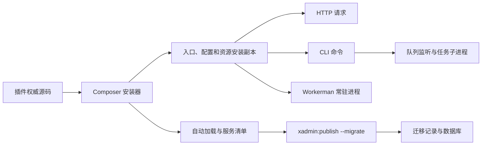

# 架构、升级与发布约定

本文件是聚合仓库安装、升级、验收和发布规则的统一来源。整改复核基线为
`8ce414a..16b4921`。支付、商城并发和设备协议不属于本次业务审计范围。

## 模块与运行生命周期

| 模块 | 职责及直接依赖 |
| --- | --- |
| 聚合项目 | 维护插件源码、开发入口、验收与拆分；path 仓库用于开发，独立 Composer 包用于分发 |
| ThinkLibrary | 注册服务和中间件，提供 ORM、运行配置、命令、队列、迁移与备份支持 |
| static | 入口、基础配置及前端资源模板，通过外部 think-install 安装 |
| admin | 后台权限、菜单、配置、任务；依赖 Library、static |
| account | 终端账号、会员与令牌；依赖 Library |
| payment | 支付、余额、退款；依赖 admin、account |
| wemall | 商品、订单、会员与返佣；依赖 account、payment，支付事件驱动订单状态 |
| wuma | 物码、库存、代理与标签；依赖 admin、wemall |
| wechat / wechat-service | 微信公众号与开放平台；依赖 Library、微信 SDK 和安装器 |
| center | 插件信息及管理入口；依赖 Library |
| worker | 基于 Workerman 的 HTTP 和自定义进程；依赖 Library，实际运行时不是 Swoole |
| helper | 开发期模型与索引辅助；要求 PHP 8.1+，不纳入 PHP 7.2 运行依赖 |
| think-install | 外部 Composer 插件，负责复制、初始化、包清理和安装后的发布命令；不在本仓修改 vendor |



- HTTP：public/index.php → RuntimeService::doWebsiteInit → Http::run/end；
  Library 初始化时注册中间件，HttpEnd 清理请求内 sysvar。
- CLI：think → RuntimeService::doConsoleInit → Console::run；框架拥有自动退出和异常捕获设置，
  项目入口不额外 exit。调用方关闭自动退出后获得返回码，关闭异常捕获后接收原异常。
- Workerman：xadmin:worker → HttpServer::onWorkerStart → ThinkApp，每个工作进程初始化一次；
  每次请求复用应用，重置请求、会话、视图和查询计数，再执行 Http::run/end。
- 队列：xadmin:queue listen 扫描等待任务，任务子进程执行 dorun 并记录状态；
  失败任务状态与监听进程状态分别验收，任务失败不要求整个监听进程退出。

## 文件所有权与配置

| 权威源 | 安装位置 | 更新规则 |
| --- | --- | --- |
| static 的 stc/think、stc/public/index.php | think、public/index.php | copy 的 ! 强制替换，不能在安装副本长期维护修改 |
| static 的 stc/config、.env.example、自定义样式模板 | config、.env.example、public/static/extra | init：目标文件已存在则保留 |
| static 的 plugs、theme 和内置脚本 | public/static 对应位置 | copy/! 更新；目标或父目录存在 ignore 时跳过 |
| admin、wechat 的 src | app/admin、app/wechat | 强制替换；发布包安装后可清理 vendor 中的源包 |
| 各插件 stc/database | database/migrations | 安装器 copy 更新；迁移记录决定是否执行，不能通过删记录重跑生产迁移 |
| worker 的 stc/worker.php | config/worker.php | init 保留用户配置 |
| 用户 .env、自定义配置和业务文件 | 站点目录 | 用户所有，不纳入模板清理或强制重置 |
| installed.json | vendor/services.php、versions.php | Publish 根据实际安装包重新生成，不能手工维护生成结果 |

xadmin:publish 还发布应用模块内的 config、public、database：配置和迁移默认不强制覆盖，
静态资源覆盖；--force 会扩大覆盖范围，常规升级不使用。迁移改名清理由现有 Publish 实现处理，
不能用目录清理替代迁移兼容设计。

配置顺序：应用初始化加载环境与 config；运行模式、应用映射和域名映射由 runtime/.env 合并。
旧 migration 3.0.0 读取 database 顶层，而 ORM 读取 connections。Library::boot 仅用默认连接补齐
缺失的顶层项，保留显式值和整个 connections。该逻辑在 HTTP、CLI 和 Worker 共享执行；
只有观察到副作用且存在现成接入点时才收敛，不能搬到不负责连接配置的 config/phinx.php。

## 近期提交处置

| 提交 | 处置与依据 |
| --- | --- |
| ef91cf6 | 保留旧迁移连接兼容、PDO 失败显式异常、通用字段类型及既有 PhinxExtend 复用；以真实安装升级和配置一致性复核影响 |
| 1af53b6 | 保留示例 MySQL 主机和 Redis 库号修正；实际用户 .env 不修改 |
| 5eecf72 | 保留统一测试入口、源码 SHA 固定、冲突预检和并发保护；补真实安装器、真实拆分及发布证据关联 |
| 16b4921 | 保留无额外 exit 的入口和 Publish 直接运行迁移子命令；其普通异常测试不能代替所有 Throwable 与初始化失败验收 |

最小修正：真实安装器补验已复现并修正根项目自动加载缺陷，原 app\index\ 映射只能加载首页模块。
发布包复制 app/admin、app/wechat 并清理 vendor 后，对应服务无法注册。根项目改为 app\ → app/，
延续框架原有应用目录规则；path 与 dist、基础与完整插件组合均通过真实服务注册检查。

命令失败状态阻断：PHP 7.2/ThinkPHP 6.1 和 PHP 8.2/ThinkPHP 8 两条依赖线中，
原生 Console 与本仓入口对 Error/TypeError、服务 boot 异常均可输出错误但以 0 退出。
Console::run 只捕获 Exception，初始化又发生于 run 之前；全局异常处理器只 report/render。
tests/check-console.php 同时运行项目入口、static 模板和不注册 Library 的原生框架对照，
发现上述行为时返回非零。原生对照定位的是行为边界，不能单凭该结果笼统认定框架有问题，
也不能将项目的“真实失败非零”要求改为接受 0。此项解决前不得将验收标记为通过；保持入口
无额外 exit、不改写共享异常处理器、不修改 vendor 的约束，通过原失败场景才能解除阻断。

2026-10-14 继续核查官方版本：6.1、8.x 分支最新提交仍分别为 bc1045b、ced4837，与本次验收锁定
的提交一致。另在 Docker 内仅安装官方框架、不加载 ThinkLibrary 的最小应用中验证稳定版：

| PHP / 框架 | Error / TypeError / 服务 boot 异常的实际退出码 | 调用方控制 |
| --- | --- | --- |
| 7.2.34 / v6.1.5（57d1950） | 0 / 0 / 0，失败 | 关闭自动退出后返回、捕获原异常均通过 |
| 8.2.34 / v8.1.4（8e7b2b2） | 0 / 0 / 0，失败 | 关闭自动退出后返回、捕获原异常均通过 |

因此切换到这两个稳定版也不能解除阻断。已有 autoExit、catchExceptions 开关控制正常，
但不能补齐 Throwable 捕获，也不能覆盖发生于 Console::run 之前的初始化异常。
项目要求覆盖命令执行和未捕获的初始化失败；两者不在同一个捕获范围内，不能用全局退出补丁
替代责任边界分析。行为位置可对照官方 [Console::run](https://github.com/top-think/framework/blob/57d1950a1844ef8d3098ea290032aeb92e2e32c3/src/think/Console.php)
和 [Error::appException](https://github.com/top-think/framework/blob/8e7b2b2364047cbf71a38c4e397a9ca0d4ef2b01/src/think/initializer/Error.php)。

嵌套调用还需区分 `find()->run()` 和 ThinkPHP 的 `Console::call()`：后者会将当前控制台的
catchExceptions 设为 false，且不会恢复。即使内层命令成功，随后外层抛出普通异常也可能由
全局处理器输出后以 0 退出。Publish 已使用前者执行迁移，应保留；队列的命令调用外层已有
Throwable 捕获并记录任务失败，不能为了退出码统一改写所有 call 调用。
补充验收同时覆盖两种嵌套方式，调用方关闭自动退出后的继续执行，以及覆盖整个入口的
try/catch 接收配置和服务启动异常。失败命令在关闭自动退出时允许非零返回或原异常传递；明确关闭
异常捕获时必须传递原异常，不以强制退出满足进程验收。

PHP 7.2 原生对照还复现了 think-helper 3.1.12 的语法错误：Arr::random 的函数调用含尾随逗号，
但该包仍声明 PHP >=7.1。ThinkLibrary 已有 conflict 排除该版本，本项目四组锁文件均为 3.1.11，
应保留此约束；上述 PHP 7.2 稳定版对照也使用 3.1.11，避免无关依赖错误干扰结论。
本次未调整项目依赖、vendor 或异常处理行为，原生复现、锁文件和失败日志保留在本地验收证据中。

## 验收与证据

Docker 统一入口为 `bash tests/docker/run.sh`，依次运行既有四组矩阵：

| PHP | ThinkPHP / migration | MySQL | 范围 |
| --- | --- | --- | --- |
| 7.2 | ^6.1 / 3.0.0 | 8.4 | 原完整回归与新增验收 |
| 8.2 | ^8.1 / ^3.1 | 8.4 | 原完整回归与新增验收 |
| 7.2 | ^6.1 / 3.0.0 | 5.7 | 升级与新增验收 |
| 8.2 | ^8.1 / ^3.1 | 8.0 | 升级与新增验收 |

两条 PHP 依赖线均验 SQLite。也可指定单组：
`bash tests/docker/run.sh 8.2 8.4 full`。MySQL 8 专有默认表达式不作为 5.7 的支持承诺。
PHP 7.2 镜像仅用于旧版本兼容验收，不作为生产运行镜像。

- composer test / tests/run.php：现有核心与业务回归、权限、令牌及隔离 CLI 迁移。
- tests/check-console.php：真实进程退出码、初始化失败、Throwable、嵌套调用及调用方控制权。
- tests/check-composer.php sqlite|mysql：真实安装器、path/zip 两种分发、后台基础组合与全部运行插件，
  新装、模拟旧库更新、失败重试、锁文件重装、配置保留、服务注册及独立库恢复余额样本；
  已安装站点补验普通异常、未定义函数和参数类型错误的失败迁移，核对 shell/进程状态及迁移记录。
- tests/check-lifecycle.php：HTTP、Workerman 连续请求、异常恢复、请求状态和会话隔离，以及队列生命周期。
- tests/check-release.php：真实 splitsh、本地 bare 仓库、发布凭据、标签冲突、重跑、过期来源与并发覆盖保护；
  源码仓库和远端均为隔离夹具，门禁输入是合成证据，不能冒充主仓发布或数据库验收结果。

依赖准备发生在容器内的源码快照，不挂载宿主 .env、vendor 或数据库。真实安装测试使用锁文件
对应的本地包仓库，关闭 Packagist，预置 binarys.php 防止安装器上报主机标识。安装器本身及其
安装、更新、post-autoload-dump 事件照常执行。

每组证据保存在 runtime/acceptance：源码 SHA、工作区差异、源码归档哈希、镜像 ID、依赖锁文件、
PHP/Composer 版本、各检查日志和退出状态。各独立检查全部执行，任一失败使整组失败。
带工作区改动的结果仅用于开发验收，不能作为发布某一 Git 提交的证明。
复现某组已记录依赖时，在对应源码上设置 THINKADMIN_ACCEPTANCE_LOCK 为该组证据内 composer.lock
的绝对路径，再运行单组 Docker 命令；依赖准备将改用 install，避免重新解析版本。

真实 Composer 验收的旧库通过截断迁移至 20241010000009 构造，不能冒充生产快照。
独立数据库恢复覆盖余额样本；全表结构、索引、触发器、序号、精度与损坏备份行为由既有
PhinxRoundTripTest 覆盖。生产规模、真实支付通道、设备和切流仍需现场验收。

### 2026-10-14 本地验收结果

以下为本次开发快照的实际结果，工作区差异已经记录，不能作为某一干净提交的发布凭据。

| 环境 | 既有回归或升级 | 真实 Composer、恢复样本与服务生命周期 | 命令失败状态 | 整组结果 |
| --- | --- | --- | --- | --- |
| PHP 7.2 / MySQL 8.4 / SQLite | 已通过，137 tests / 689 assertions | 已通过 | 失败 | 失败 |
| PHP 8.2 / MySQL 8.4 / SQLite | 已通过，137 tests / 689 assertions | 已通过 | 失败 | 失败 |
| PHP 7.2 / MySQL 5.7 / SQLite | 已通过，安装与升级 | 已通过 | 失败 | 失败 |
| PHP 8.2 / MySQL 8.0 / SQLite | 已通过，安装与升级 | 已通过 | 失败 | 失败 |

四组共完成 40 个真实 Composer 场景，包含 path/dist、新装、模拟升级、唯一约束失败与按锁文件
重试，并验证 `--no-dev --optimize-autoloader`。语法、包元数据、既有代码风格范围与新增脚本
检查已通过。PHPUnit 11 仍报告既有测试注解弃用提示。

实际 PHP 为 7.2.34、8.2.34；框架分别锁定为 6.1.x-dev（bc1045b）、8.x-dev（ced4837），
迁移为 v3.0.0（0ca9582）、3.1.x-dev（a72129d），安装器为 dev-master（07ce1b1）。
完整提交号、其他依赖与镜像标识以各组 composer.lock、dependencies.json 和 images.txt 为准。

真实 splitsh 与本地 bare 仓库的隔离发布演练已通过，覆盖失败阻断、拆分目录树、标签绑定、
重复发布、远端偏移、冲突、过期来源和并发保护。主仓正式发布资格仍受阻：每组命令检查均复现
三个入口的 Error、TypeError、服务 boot 异常退出码为 0；四组总退出码均为 1，没有生成有效发布凭据。
真实远端推送、主仓标签发布、生产全量恢复和现场切换均未运行。

### 2026-10-14 定向补验

沿用上轮锁文件，在 Docker 的 PHP 7.2 / ThinkPHP 6.1、PHP 8.2 / ThinkPHP 8 中补齐命令检查。
每条依赖线均执行 41 个场景：29 通过、12 失败。失败为根入口、static 入口和原生框架对照各自
出现的四类零退出：Error、TypeError、服务 boot 异常，以及 Console::call 成功后外层普通异常。
调用方关闭自动退出的 7 个场景、关闭异常捕获的 5 个场景和初始化异常传递的 2 个场景全部通过。

两条依赖线的 SQLite 安装、历史库升级、配置与数据保留、失败重试和重复执行均通过，覆盖
无前缀及 tenant_；当前 Publish 的直接子命令调用仍能让普通迁移异常返回非零。
真实 splitsh / 本地 bare Git 补验共 9 组通过，新增覆盖单项失败与总状态冲突、重复检查、缺失
日志和矩阵，以及第二个插件拒绝推送后的局部成功、凭据阻断和修复后重跑。

本轮仅修改验收脚本及本文，未修改 ThinkPHP、业务运行代码或两个 think 入口。
PHP 7.2 首次依赖下载曾出现 SDK 压缩包损坏，隔离重新下载后恢复，原日志保留。
PHP 8.2 上述结果来自首次有效补验；最终复跑在连续两次 ip2region 下载连接中断后停止依赖
准备，未进入测试，单独记为环境受阻。最终脚本的 PHP 8.2 语法检查已通过，不以语法检查
代替运行结果；调整后断言的运行复核已在 PHP 7.2 完成。
证据位于本地 runtime/acceptance/followup.n2Wglw，记录实际源码差异、依赖、镜像和日志；
这些是定向开发验收，不是新的完整四矩阵发布凭据。MySQL、HTTP、Workerman 和队列沿用前轮
结果，本轮未重跑。命令退出码仍失败，生产更新与正式发布继续受阻。

### 2026-10-14 验收口径与真实迁移复核

曾将 Error、TypeError、服务 boot 异常和 Console::call 后外层异常的退出码 0 标为
`framework-handled`，由此得到的四组全绿不满足原验收要求。该断言调整已撤回，未提交到代码库；
“框架已输出错误”和“部署能够识别失败”必须分别判断。以下目录保留原始记录，但不得用其中的
命令通过状态认定发布通过：

- php7.2-mysql8.4.6wSpPE、php8.2-mysql8.4.Kgs0Zk；
- php7.2-mysql5.7.viBdSh、php8.2-mysql8.0.GbVlVB。

上述四组均包含未提交改动；逐组调用 verify-acceptance.php 已确认现有发布门禁拒绝这些凭据。

本轮沿用上述锁文件，在 Docker 中重新运行两条依赖线的原命令门禁，并补验真实 Composer
安装后的 SQLite 站点。入口哈希与 static 模板一致，没有替换应用初始化调用；安装器原有
post-autoload-dump 钩子实际执行。临时迁移分别触发普通异常、未定义函数和参数类型错误，
同时从 shell 和进程接口读取状态，再检查失败迁移没有登记完成。

| Docker 依赖线 | 命令门禁 | 普通迁移异常：Publish / Composer | 未定义函数及类型错误：Publish / Composer |
| --- | --- | --- | --- |
| PHP 7.2.34 / ThinkPHP 6.1 | 29/41 通过，12 失败 | 1 / 1，已通过 | 均为 0 / 0，失败 |
| PHP 8.2.34 / ThinkPHP 8 | 29/41 通过，12 失败 | 1 / 1，已通过 | 均为 0 / 0，失败 |

两条依赖线共 12 项迁移故障检查：4 项通过、8 项失败；shell 与进程采集一致，失败迁移记录均为
0。故障注入用于验证升级失败能否被识别，不代表现有业务迁移含有这些编程错误。每条依赖线原有
5 个 Composer 安装场景继续通过，包含配置、数据、重复执行和恢复检查；此次新增故障场景的
MySQL 分支未运行。MySQL、HTTP、Workerman、队列和真实 splitsh 沿用此前各自有效的验收结果，
没有用 SQLite 结果替代其他环境。

证据保存在本地 runtime/acceptance/command-recheck.7qb44s，含源码差异、镜像、依赖锁文件和
实际输出。两组检查最终状态均为失败，不能生成发布凭据。新增脚本通过 PHP 7.2/8.2 语法检查，
本次测试差异通过代码风格检查；故障迁移、站点和容器均已清理。原生对照及真实安装结果共同说明
当前调用链的失败状态不足以满足项目部署要求；本轮仅补验收与说明，没有修改运行时代码、
ThinkPHP 或两个 think 入口，也未添加全局退出补丁。正式发布及生产更新继续受阻。

## 拆分与标签发布

主仓 CI 与本地调用同一 Docker 入口，失败也上传证据。split 作业等待四组检查全部成功，
下载该次运行的证据；verify-acceptance.php 再核对源码提交、干净工作区、矩阵完整性和各检查状态。
检查缺失或失败都不生成可用于发布的凭据。
本地历史验收结果默认保留；本地拆分时通过 THINKADMIN_ACCEPTANCE_DIR 指向仅包含本次四组证据的
目录，避免混入旧结果或重复矩阵。CI 自动收集本次运行的四组产物。

真实 splitsh 从固定源提交拆分；全部插件推送成功后才输出 split.tsv 与 acceptance.json。
前者记录源 SHA、分支、验收摘要哈希及每个插件的拆分 SHA，后者记录依赖锁文件和镜像证据哈希。
部分拆分失败时修复后重跑，不把局部成功当作整体发布成功。

从对应 CI 运行下载 release-manifest-<源码 SHA>，在该源码提交的干净分支上预检：

```sh
bash .github/release.sh --dry-run --manifest /path/to/split.tsv vX.Y.Z [插件名 ...]
```

获得实际发布授权后，同一命令去掉 --dry-run 才创建并推送指定标签。--manifest 为必填，
脚本核对源提交、凭据哈希、全部目标的远端分支与拆分 SHA，任一不符在创建标签前失败。
同一标签指向同一已验收拆分时可重跑，指向其他提交时拒绝覆盖。插件 GitHub Release 仍绑定
触发标签，允许重跑和补发既有标签；根项目 Release 仍等待四组验收。

这个对应关系证明正常维护脚本发布的代码来源，不是签名或权限系统：有远端写权限的人仍能绕过
维护脚本手工打标签。应按现有仓库权限管理限制实际发布入口，本轮不修改远端规则。

## 更新与恢复

1. 在预发布环境使用目标依赖锁文件和对应源码执行上述验收，确认没有失败或阻断。
2. 备份现有源码版本、composer.lock、用户配置和数据库，记录恢复目标并验证备份可读取；
   在独立数据库演练实际所需恢复，不覆盖在线数据库。
3. 安排维护窗口，停止写入来源及旧 Worker/队列，使用已验收的锁文件执行
   `composer install --no-dev --optimize-autoloader`，由安装器触发 Publish 和迁移。
4. 同时检查命令状态、迁移记录与服务可用性；当前已知异常退出阻断未解除时不进入生产更新。
   成功后重启常驻进程，验证正常请求、失败请求后的恢复及队列任务，再恢复业务写入。
5. 失败时保留日志和迁移记录，修复原因后按锁文件重试。MySQL DDL 可能隐式提交；
   若需要恢复，按已演练步骤恢复数据库与匹配代码，不能仅回退代码假定数据已回退。

真实推送、标签发布、生产备份恢复和流量切换需要对应操作授权；本地验收不会执行这些操作。

## 2026-10-15 本月回归修复复核

本次针对 `40c4163..04c9cc3` 的复核确认并修复两处本月新增问题：

| 问题 | 修复 | 结果 |
| --- | --- | --- |
| PHP 7.2 / migration 3.0.0 的 SQLite PDO 静默模式下，备份约束失败只返回 false，恢复行数仍递增并登记迁移 | `PhinxBackup::insertRows` 显式检查 `PDOStatement::execute()`，失败抛出异常并复用既有保存点回滚；新增静默 PDO 回归测试 | PHP 7.2 实际冲突恢复：退出 1、实际 0 行、无迁移记录；PHP 8.2 同场景通过 |
| Wemall 新迁移直接使用 `PhinxSchema`，但 Composer 允许只保留旧 ThinkLibrary | Wemall 直接声明 `zoujingli/think-library` 为 `^6.1.100|dev-main|dev-master`；`v6.1.99` 不含该类，`v6.1.100` 起提供 | 只更新商城且不允许依赖联动时 Composer 安全拒绝；使用验收入口的 `--with-all-dependencies` 自动更新 Library 后迁移通过；两包同步更新通过 |

修复后的定向包测试在 PHP 7.2 / ThinkPHP 6.1 和 PHP 8.2 / ThinkPHP 8 均通过：ThinkLibrary 61 tests / 420 assertions，Wemall 18 tests / 89 assertions。四组 Docker 验收中，语法、元数据、核心回归或升级、生命周期和拆分发布检查通过；Console 与 Composer 检查仍因既有 Error、TypeError、boot 及嵌套命令失败返回 0 的门禁而失败，四组没有生成发布资格凭据。该既有阻断未在本次月度回归修复中扩大处理，生产上线仍须先解除命令失败门禁并重新跑完整矩阵。

本次证据保存在 `runtime/acceptance/month-review.rhikyb` 及四组新验收目录；当前工作区的修复差异可通过 `git diff` 复核。未执行真实远端推送、标签发布、生产数据库恢复或现场切换。
